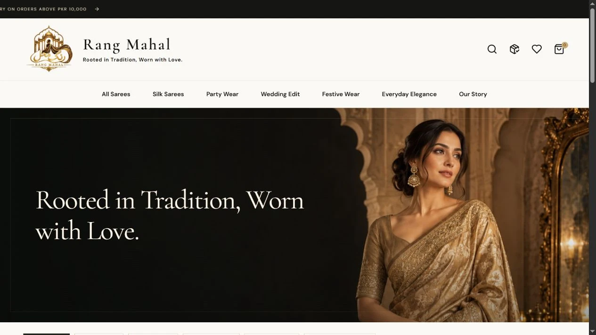
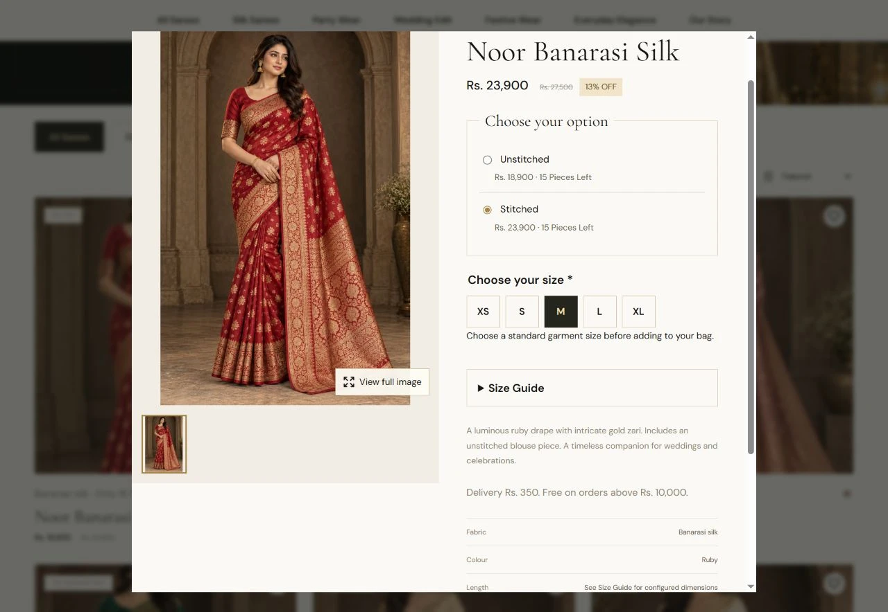

<div align="center">
  
  <h1>Rang Mahal</h1>
  <p><strong>Rooted in Tradition, Worn with Love.</strong></p>
  <p>A Pakistani saree storefront with guest checkout, standard stitched sizes and a complete retail administration workflow.</p>
  <p><a href="https://rangmahal.site/">Live website</a> · <a href="https://rangmahal.site/track">Track an order</a> · <a href="deploy/RETAIL-OPERATIONS.md">Operations guide</a></p>
  <p><strong>Laravel 12 · PHP 8.2+ · React 19 · Vite · MySQL</strong></p>
</div>



## The project

Rang Mahal celebrates Pakistani culture through sarees, traditional colours and graceful drapes. A black, gold and cream storefront brings together responsive shopping, inventory management and order fulfillment.

This repository contains the React frontend, Laravel backend, MySQL migrations, compiled assets, tests and deployment guides. The earlier Next.js implementation remains in Git history; the current application runs on PHP hosting.

## Product experience



The product viewer preserves the complete image, with fullscreen viewing, zoom, photo navigation and an optional video. Stitched products require an enabled XS, S, M, L or XL size that stays attached to the bag and purchase. These compressed WebP screenshots show public-facing application screens; prices and availability reflect the capture and may change.

## Features

| Customer storefront | Retail administration |
| --- | --- |
| Responsive homepage, collections, search and wishlist | Overview metrics, filters and business reports |
| Right-side bag and guest checkout | Seven-step product creation and review |
| Stitched/unstitched options and XS–XL sizes | Draft, published and archived products |
| Garment size guides with inches/cm display | Global and product-specific size charts |
| Multiple photos, fullscreen zoom and optional video | Five image slots and one video per product by default |
| Cash on delivery and admin-controlled bank transfer | Prices, stitching charges and restricted cost fields |
| Inline required-field validation | Shared/separate stock and low-stock thresholds |
| Tracking with order reference **and checkout email** | Brands, categories, category images and CSV import/export |
| Branded order and status-update emails | Fulfillment confirmations and shipping records |
| Shipping, returns, care and payment information | Staff roles, permissions and notification attempt history |

Card payments remain disabled until a gateway is integrated. Customer registration and customer dashboard access are disabled; checkout does not require an account.

## Product creation workflow

1. **Product information:** name, description, brand/category selection or authorized inline creation, SKU and featured status.
2. **Images & video:** upload, preview, replace, remove, reorder and choose a primary image; optionally add one video.
3. **Pricing:** base price, stitching charge, discounts and permission-protected costs.
4. **Stitching & sizes:** enabled sizes and an optional product-specific garment chart.
5. **Inventory:** quantities, shared/separate stock, inventory tracking and low-stock threshold.
6. **Shipping:** weight, delivery information and restriction notes.
7. **Review & publish:** customer preview, Save as Draft or Publish.

Drafts remain hidden from customers. Order-item snapshots preserve purchase-time prices, stitching charges, SKU and selected sizes.

## Orders and notifications

**Pending → Confirmed → Processing → Packed → Shipped → Out for Delivery → Delivered**

Customers see **Ready for dispatch** for Packed and **Dispatched** for Shipped. Cancellation before dispatch restores reserved stock once; delivered orders may be marked Returned. Payment/refund records remain separate from delivery status.

Staff review and confirm status changes. Courier fields appear at the relevant preparation/dispatch stages and are withheld from customers until dispatch. Direct delivery and collection are supported without a courier.

Branded emails include order details, selected sizes, tracking reference and applicable shipping information. A durable outbox records transport attempts and retries failures without creating another order. Identical repeated status requests do not enqueue duplicate notifications. Real delivery requires a configured mail transport and the email worker documented in the [retail guide](deploy/RETAIL-OPERATIONS.md).

## Media and sizing

- **Images:** JPEG, PNG or WebP, up to 8 MB each, 4096 pixels per side and 12 megapixels. Stored as compressed WebP, preserving supported transparency and allowed source proportions.
- **Video:** one MP4/WebM upload or direct HTTPS video URL; the default upload cap is 20 MB.
- **Configurable limits:** five image slots by default, with configurable image/video caps subject to hosting limits.
- **Metadata:** actual file size, image dimensions, media ordering and primary-image designation.
- **Maintenance:** `php artisan media:prune` previews eligible old unreferenced managed uploads. `--execute` moves them to private quarantine; legacy/unregistered files are untouched.
- **Measurements:** enter actual Rang Mahal blouse, saree and pallu dimensions in admin. Unknown dimensions are clearly marked. An attributed manufacturer body-sizing reference is separate from Rang Mahal garment specifications.

A clearly labelled gallery demonstration is available at `/gallery-demo` **locally only**. It creates no inventory or customer orders.

## Run locally

Requirements: PHP 8.2+, Composer, MySQL and Node.js/npm for frontend builds. Image processing requires PHP GD with WebP support; uploads use Fileinfo. XAMPP supplies local Apache/MySQL services.

### Fresh development installation

```sh
git clone https://github.com/Umersaleem98/zariya-saree-store.git
cd zariya-saree-store
composer install
```

Copy `.env.example` to `.env`. Create an empty development MySQL database, configure `DB_*`, and set your own `ADMIN_EMAIL` and unique `ADMIN_PASSWORD` of at least 12 characters. Existing dashboard passwords are not published here.

```sh
php artisan key:generate
npm ci
npm run build
php artisan migrate --seed
php artisan serve --host=127.0.0.1 --port=8000
```

For the built-in server, set `APP_URL=http://127.0.0.1:8000`. Open the storefront there and staff sign-in at `/admin`. Seeding is for a **fresh development database**, not an existing production store.

### Existing XAMPP installation

Start **Apache** and **MySQL** in XAMPP.

| Item | Location |
| --- | --- |
| Project | `C:\xampp\htdocs\zariya-saree-store` |
| Storefront | [localhost:8088](http://localhost:8088/) |
| Staff sign-in | [localhost:8088/admin](http://localhost:8088/admin) |
| Gallery demonstration | [localhost:8088/gallery-demo](http://localhost:8088/gallery-demo) |

The source checkout and XAMPP installation are separate copies. After building, use `scripts/sync-xampp.ps1` to sync source/assets while preserving the XAMPP `.env`, dependencies and runtime storage. Apache must serve only `public/`; see `deploy/xampp-zariya.conf`.

## Verification and security

```sh
npm run build
php artisan test
```

The retail upgrade passed the production build and 31 tests. Coverage includes sizes and purchase snapshots, checkout fields, prices, stock, permissions, drafts/publishing, five-image uploads, actual MP4 upload and range playback, status transitions, notification attempts/retries and media quarantine. Targeted notification tests were rerun after the final email corrections.

Tests use transactions in a **development MySQL database**, with fake/array mail transport. Never point tests at production. Existing products, orders, stock and permission assignments were compared before and after deployment. Browser checks covered mobile alignment, full-image viewing, sizes in checkout, inline errors, media playback, the product wizard and standalone tracking. Physical-device swipe remains a manual acceptance check.

Staff access uses Laravel sessions, CSRF-protected mutations, backend permissions and login throttling. Prices and stock are checked on the server with database transactions. Disabled staff and access changes invalidate existing sessions. Credentials, `.env`, dependencies and runtime data stay outside Git.

## Deployment and documentation

The live Laravel application runs at **[rangmahal.site](https://rangmahal.site/)** on GoDaddy cPanel with HTTPS and MySQL. Deployment backs up files/database, runs migrations, publishes public assets and refreshes application caches.

| Guide | Contents |
| --- | --- |
| [Retail operations](deploy/RETAIL-OPERATIONS.md) | Latest schema, sizing, wizard, media, fulfillment, testing and limitations |
| [Production deployment](deploy/README.md) | cPanel updates, backups and recovery |
| [Business platform](deploy/BUSINESS-PLATFORM.md) | Settings, shipping, stitching and analytics |
| [Commerce operations](deploy/COMMERCE.md) | Earlier implementation; retail guide supersedes old media/sizing limits |
| [Hosting requirements](DEPLOYMENT.md) | General PHP hosting setup |
| [Project links](LINKS.md) | Store and administration addresses |

Netlify cannot run Laravel/PHP. Laravel pushes use `[skip netlify]`; the earlier Netlify preview is not the current production store.

**Operational inputs and limitations:** supply real garment measurements and multi-view product photos. Courier updates are entered manually; no courier API or card gateway is integrated. Weight/restriction notes do not create a new shipping-rate engine. Mail-server acceptance does not guarantee inbox placement.
